  <picture>
    <source media="(prefers-color-scheme: dark)" srcset="media/title-dark.svg">
    
  </picture>

I build full-stack web apps, tools and experiments with LLM agents, and on the side, games. Mostly **TypeScript**, **Python** and **Godot**.
By day I build low-code business apps in Mendix at **Low-Code Solutions Experts**.
I'm finishing an engineering degree.

Most of what I build started as a tool I needed myself. Lately that means tools for the AI agents I work with every day.

---

#### 🧪 Open source

| Project | What it is |
|---|---|
| **[self-compact](https://github.com/bobred18/self-compact)** | Claude Code plugin: the agent compacts its own context at a phase boundary and resumes from a note it wrote. |
| **[BrudWawa](https://github.com/bobred18/BrudWawa)** | Civic issue reporting for Warsaw. Photograph a problem and Gemini classifies it, rates the threat and suggests the city service. |
| **[moniooshko](https://github.com/bobred18/moniooshko)** | Generates and scores chord progressions in real time, with playback and MIDI/audio export. PyQt5 + FluidSynth. |

#### 🎮 Games in development

| Game | What it is |
|---|---|
| **Rollionaire** |  A beetle rolls a growing ball of junk into its hoard before dawn. The ball is your cargo, your weapon and your weak point. Godot 4 + Jolt, tuned over 30+ recorded playtests. |
| **nsg** |  First-person lunar survival builder. Godot 4. |
| **Bombeavers** |  2v2 arcade: a bomb-bus that must hold a minimum speed or it explodes. |

---

  

<picture>
  <source media="(prefers-color-scheme: dark)" srcset="https://raw.githubusercontent.com/bobred18/bobred18/output/snake-dark.svg">
  
</picture>
